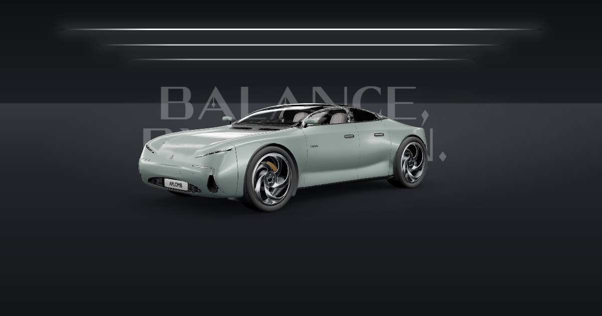

# Aplomb Cordeau

A fictional four-door GT, electric or straight-six, in real-time 3D on the web. The car drifts out of
the page on a wet road and arrives in the showroom; the visitor then configures its paint, wheels,
cabin and energy, and watches it leave as they made it.

**Live:** https://adamrodwebdev.github.io/aplomb-cordeau/

A portfolio piece by [AdamRodWebTech](https://adamrodwebdev.com). Aplomb and the Cordeau are fictional:
nothing is for sale, no form sends anything, and the prices and figures are illustrations.

## What it shows

- **A story in six chapters:** the road at dawn, the showroom, the exterior, the cabin, the energy and
  the finale. The light follows it: dawn, a white or night studio, the warm workshop for the Six or the
  blue night for the E, then dusk. The paint reflects each one.
- **A configurator inside the scene:** eight paints, three wheel designs and their finishes, calipers
  and brightwork, four interior trims, five inlays, the light blade's colour, two energies and their
  versions. The price rolls like a counter. On a wide screen the choices sit in a compact dock in tabs,
  which folds away to leave the render whole.
- **The straight-six opens** into an exploded view as you scroll, with notes on its parts.
- **For every visitor:** a keyboard table of contents (the plumb line at the edge), light and dark
  themes, reduced motion respected (the page then stacks as bands), no horizontal scroll from 320 to
  2,560 px.

## How it is built

- Plain HTML, CSS and JavaScript modules: no framework and no build step. three.js r186 draws the scene
  (`vendor/three`, MIT licence).
- The car, the cabin and the engine come from our own procedural generators in Blender, exported as
  glTF with meshopt compression. The studio's lights are baked environment maps, decoded on the GPU.
- The first paint is an HTML poster of the scene's first frame; the scene boots when the visitor moves.
- Everything is served from this site: no cookies, no trackers, no request to another site. Each page
  carries a Content-Security-Policy with the hashes of its inline scripts.
- Fonts: Aplomb Estoc (our own), Archivo and Geist Mono (SIL Open Font License 1.1).

## Code map

| Path | What |
|---|---|
| `index.html`, `drift.css` | the page and its styles |
| `js/rules/` | the choreography, the catalogue and its prices: data and pure functions |
| `js/logic/` | the visitor's configuration and the scroll's state |
| `js/design/` | the scene, the configurator's panels, the docks, the index, the notices |
| `*.glb`, `environment-*.png`, `poster-*` | the models, the lights and the first frame |
| `legal.html`, `404.html` | the legal notice and privacy page, the missing page |

The site is built from the project's working repository; this repository holds what is published.
GitHub Pages serves the `main` branch.

## Credits

- [three.js](https://threejs.org/) (MIT).
- Archivo by Omnibus-Type and Geist Mono by Vercel (SIL Open Font License 1.1).
- The road's sky is derived from "Lenong 2" by [Poly Haven](https://polyhaven.com/) (CC0).

## Licence

All rights reserved: see [LICENSE](LICENSE). The third-party parts keep their own licences.
